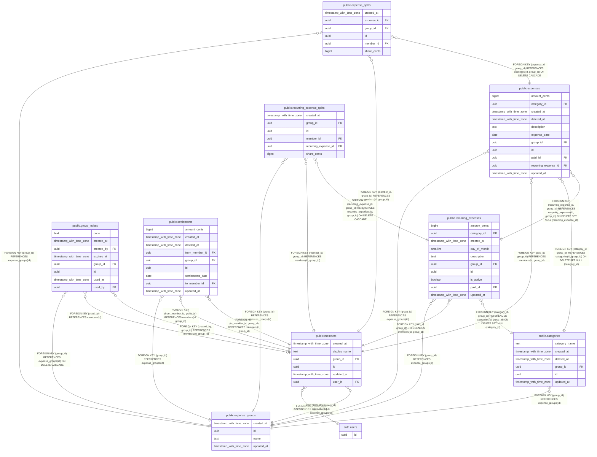

# Hestia

## Description

Esquema de la base de datos de Hestia. Se genera solo a partir de las migraciones; no se edita a mano.

## Tables

| Name                                                                  | Columns | Comment                                                                                                        | Type       |
| --------------------------------------------------------------------- | ------- | -------------------------------------------------------------------------------------------------------------- | ---------- |
| [auth.users](auth.users.md)                                           | 1       |                                                                                                                | BASE TABLE |
| [public.categories](public.categories.md)                             | 6       | Tipos de gasto de cada grupo (supermercado, ocio...). Se borran de forma suave.                                | BASE TABLE |
| [public.expense_groups](public.expense_groups.md)                     | 4       | Una familia o grupo. Todo lo demás cuelga de un grupo.                                                         | BASE TABLE |
| [public.expense_splits](public.expense_splits.md)                     | 6       | Reparto de un gasto: una fila por miembro con la parte que le toca. Se crean junto al gasto y no se editan.    | BASE TABLE |
| [public.expenses](public.expenses.md)                                 | 11      | Hecho central: alguien pagó una cantidad por algo. El saldo no se guarda, se calcula a partir de estas filas.  | BASE TABLE |
| [public.group_invites](public.group_invites.md)                       | 8       | Códigos de invitación para entrar en un grupo. Caducan y son de un solo uso. Solo se tocan mediante funciones. | BASE TABLE |
| [public.members](public.members.md)                                   | 6       | Una persona dentro de un grupo. Se enlaza con la cuenta de login de Supabase.                                  | BASE TABLE |
| [public.recurring_expense_splits](public.recurring_expense_splits.md) | 6       | Reparto de una plantilla recurrente. Igual que expense_splits.                                                 | BASE TABLE |
| [public.recurring_expenses](public.recurring_expenses.md)             | 10      | Plantilla de un gasto que se repite cada mes. No es un gasto: genera uno real cada mes.                        | BASE TABLE |
| [public.settlements](public.settlements.md)                           | 9       | Pagos entre dos miembros para saldar deuda. No son gastos: no hay compra ni categoría.                         | BASE TABLE |

## Stored procedures and functions

| Name                   | ReturnType | Arguments                                                                                                                                                                              | Type     |
| ---------------------- | ---------- | -------------------------------------------------------------------------------------------------------------------------------------------------------------------------------------- | -------- |
| auth.uid               | uuid       |                                                                                                                                                                                        | FUNCTION |
| public.create_expense  | uuid       | p_id uuid, p_group_id uuid, p_paid_id uuid, p_amount_cents bigint, p_description text, p_splits jsonb, p_category_id uuid DEFAULT NULL::uuid, p_expense_date date DEFAULT CURRENT_DATE | FUNCTION |
| public.create_group    | uuid       | p_name text, p_display_name text                                                                                                                                                       | FUNCTION |
| public.create_invite   | text       | p_group_id uuid                                                                                                                                                                        | FUNCTION |
| public.is_group_member | bool       | p_group_id uuid                                                                                                                                                                        | FUNCTION |
| public.join_group      | uuid       | p_code text, p_display_name text                                                                                                                                                       | FUNCTION |
| public.set_updated_at  | trigger    |                                                                                                                                                                                        | FUNCTION |

## Relations

---

> Generated by [tbls](https://github.com/k1LoW/tbls)
