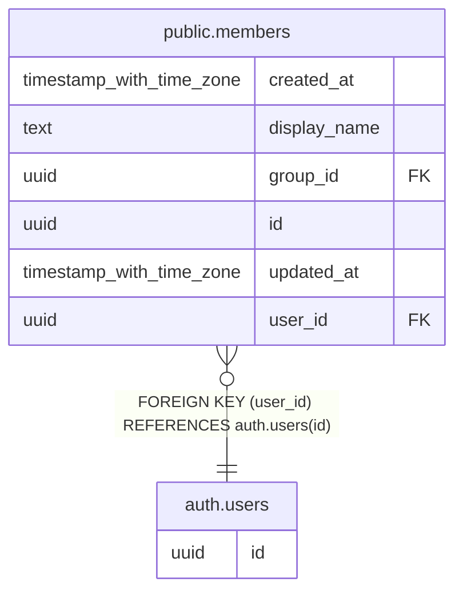

# auth.users

## Columns

| Name | Type | Default | Nullable | Children                            | Parents | Comment |
| ---- | ---- | ------- | -------- | ----------------------------------- | ------- | ------- |
| id   | uuid |         | false    | [public.members](public.members.md) |         |         |

## Constraints

| Name       | Type        | Definition       |
| ---------- | ----------- | ---------------- |
| users_pkey | PRIMARY KEY | PRIMARY KEY (id) |

## Indexes

| Name       | Definition                                                    |
| ---------- | ------------------------------------------------------------- |
| users_pkey | CREATE UNIQUE INDEX users_pkey ON auth.users USING btree (id) |

## Relations

---

> Generated by [tbls](https://github.com/k1LoW/tbls)
