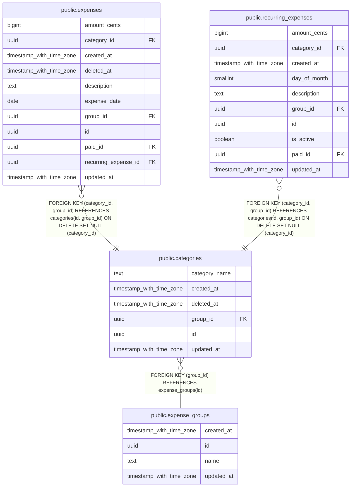

# public.categories

## Description

Tipos de gasto de cada grupo (supermercado, ocio...). Se borran de forma suave.

## Columns

| Name          | Type                     | Default           | Nullable | Children                                                                                        | Parents                                           | Comment                                                               |
| ------------- | ------------------------ | ----------------- | -------- | ----------------------------------------------------------------------------------------------- | ------------------------------------------------- | --------------------------------------------------------------------- |
| category_name | text                     |                   | false    |                                                                                                 |                                                   | Nombre de la categoría. Único entre las categorías activas del grupo. |
| created_at    | timestamp with time zone | now()             | false    |                                                                                                 |                                                   |                                                                       |
| deleted_at    | timestamp with time zone |                   | true     |                                                                                                 |                                                   | Si tiene valor, la categoría está borrada. Nunca se borra de verdad.  |
| group_id      | uuid                     |                   | false    | [public.expenses](public.expenses.md) [public.recurring_expenses](public.recurring_expenses.md) | [public.expense_groups](public.expense_groups.md) |                                                                       |
| id            | uuid                     | gen_random_uuid() | false    | [public.expenses](public.expenses.md) [public.recurring_expenses](public.recurring_expenses.md) |                                                   |                                                                       |
| updated_at    | timestamp with time zone | now()             | false    |                                                                                                 |                                                   | Se actualiza sola con un trigger. Sirve para sincronizar cambios.     |

## Constraints

| Name                           | Type        | Definition                                           |
| ------------------------------ | ----------- | ---------------------------------------------------- |
| categories_category_name_check | CHECK       | CHECK ((length(TRIM(BOTH FROM category_name)) > 0))  |
| categories_group_id_fkey       | FOREIGN KEY | FOREIGN KEY (group_id) REFERENCES expense_groups(id) |
| categories_id_group_id_key     | UNIQUE      | UNIQUE (id, group_id)                                |
| categories_pkey                | PRIMARY KEY | PRIMARY KEY (id)                                     |

## Indexes

| Name                             | Definition                                                                                                                                 |
| -------------------------------- | ------------------------------------------------------------------------------------------------------------------------------------------ |
| categories_group_name_active_key | CREATE UNIQUE INDEX categories_group_name_active_key ON public.categories USING btree (group_id, category_name) WHERE (deleted_at IS NULL) |
| categories_group_updated_idx     | CREATE INDEX categories_group_updated_idx ON public.categories USING btree (group_id, updated_at)                                          |
| categories_id_group_id_key       | CREATE UNIQUE INDEX categories_id_group_id_key ON public.categories USING btree (id, group_id)                                             |
| categories_pkey                  | CREATE UNIQUE INDEX categories_pkey ON public.categories USING btree (id)                                                                  |

## Triggers

| Name           | Definition                                                                                                      |
| -------------- | --------------------------------------------------------------------------------------------------------------- |
| set_updated_at | CREATE TRIGGER set_updated_at BEFORE UPDATE ON public.categories FOR EACH ROW EXECUTE FUNCTION set_updated_at() |

## Relations

---

> Generated by [tbls](https://github.com/k1LoW/tbls)
