# public.expense_groups

## Description

Una familia o grupo. Todo lo demás cuelga de un grupo.

## Columns

| Name       | Type                     | Default           | Nullable | Children                                                                                                                                                                                                                                                                                                                                                                                          | Parents | Comment                                                           |
| ---------- | ------------------------ | ----------------- | -------- | ------------------------------------------------------------------------------------------------------------------------------------------------------------------------------------------------------------------------------------------------------------------------------------------------------------------------------------------------------------------------------------------------- | ------- | ----------------------------------------------------------------- |
| created_at | timestamp with time zone | now()             | false    |                                                                                                                                                                                                                                                                                                                                                                                                   |         |                                                                   |
| id         | uuid                     | gen_random_uuid() | false    | [public.categories](public.categories.md) [public.expense_splits](public.expense_splits.md) [public.expenses](public.expenses.md) [public.group_invites](public.group_invites.md) [public.members](public.members.md) [public.recurring_expense_splits](public.recurring_expense_splits.md) [public.recurring_expenses](public.recurring_expenses.md) [public.settlements](public.settlements.md) |         |                                                                   |
| name       | text                     |                   | false    |                                                                                                                                                                                                                                                                                                                                                                                                   |         | Nombre visible del grupo.                                         |
| updated_at | timestamp with time zone | now()             | false    |                                                                                                                                                                                                                                                                                                                                                                                                   |         | Se actualiza sola con un trigger. Sirve para sincronizar cambios. |

## Constraints

| Name                      | Type        | Definition                                 |
| ------------------------- | ----------- | ------------------------------------------ |
| expense_groups_name_check | CHECK       | CHECK ((length(TRIM(BOTH FROM name)) > 0)) |
| expense_groups_pkey       | PRIMARY KEY | PRIMARY KEY (id)                           |

## Indexes

| Name                | Definition                                                                        |
| ------------------- | --------------------------------------------------------------------------------- |
| expense_groups_pkey | CREATE UNIQUE INDEX expense_groups_pkey ON public.expense_groups USING btree (id) |

## Triggers

| Name           | Definition                                                                                                          |
| -------------- | ------------------------------------------------------------------------------------------------------------------- |
| set_updated_at | CREATE TRIGGER set_updated_at BEFORE UPDATE ON public.expense_groups FOR EACH ROW EXECUTE FUNCTION set_updated_at() |

## Relations

```mermaid
erDiagram

"public.categories" }o--|| "public.expense_groups" : "FOREIGN KEY (group_id) REFERENCES expense_groups(id)"
"public.expense_splits" }o--|| "public.expense_groups" : "FOREIGN KEY (group_id) REFERENCES expense_groups(id)"
"public.expenses" }o--|| "public.expense_groups" : "FOREIGN KEY (group_id) REFERENCES expense_groups(id)"
"public.group_invites" }o--|| "public.expense_groups" : "FOREIGN KEY (group_id) REFERENCES expense_groups(id) ON DELETE CASCADE"
"public.members" }o--|| "public.expense_groups" : "FOREIGN KEY (group_id) REFERENCES expense_groups(id)"
"public.recurring_expense_splits" }o--|| "public.expense_groups" : "FOREIGN KEY (group_id) REFERENCES expense_groups(id)"
"public.recurring_expenses" }o--|| "public.expense_groups" : "FOREIGN KEY (group_id) REFERENCES expense_groups(id)"
"public.settlements" }o--|| "public.expense_groups" : "FOREIGN KEY (group_id) REFERENCES expense_groups(id)"

"public.expense_groups" {
  timestamp_with_time_zone created_at
  uuid id
  text name
  timestamp_with_time_zone updated_at
}
"public.categories" {
  text category_name
  timestamp_with_time_zone created_at
  timestamp_with_time_zone deleted_at
  uuid group_id FK
  uuid id
  timestamp_with_time_zone updated_at
}
"public.expense_splits" {
  timestamp_with_time_zone created_at
  uuid expense_id FK
  uuid group_id FK
  uuid id
  uuid member_id FK
  bigint share_cents
}
"public.expenses" {
  bigint amount_cents
  uuid category_id FK
  timestamp_with_time_zone created_at
  timestamp_with_time_zone deleted_at
  text description
  date expense_date
  uuid group_id FK
  uuid id
  uuid paid_id FK
  uuid recurring_expense_id FK
  timestamp_with_time_zone updated_at
}
"public.group_invites" {
  text code
  timestamp_with_time_zone created_at
  uuid created_by FK
  timestamp_with_time_zone expires_at
  uuid group_id FK
  uuid id
  timestamp_with_time_zone used_at
  uuid used_by FK
}
"public.members" {
  timestamp_with_time_zone created_at
  text display_name
  uuid group_id FK
  uuid id
  timestamp_with_time_zone updated_at
  uuid user_id FK
}
"public.recurring_expense_splits" {
  timestamp_with_time_zone created_at
  uuid group_id FK
  uuid id
  uuid member_id FK
  uuid recurring_expense_id FK
  bigint share_cents
}
"public.recurring_expenses" {
  bigint amount_cents
  uuid category_id FK
  timestamp_with_time_zone created_at
  smallint day_of_month
  text description
  uuid group_id FK
  uuid id
  boolean is_active
  uuid paid_id FK
  timestamp_with_time_zone updated_at
}
"public.settlements" {
  bigint amount_cents
  timestamp_with_time_zone created_at
  timestamp_with_time_zone deleted_at
  uuid from_member_id FK
  uuid group_id FK
  uuid id
  date settlements_date
  uuid to_member_id FK
  timestamp_with_time_zone updated_at
}
```

---

> Generated by [tbls](https://github.com/k1LoW/tbls)
