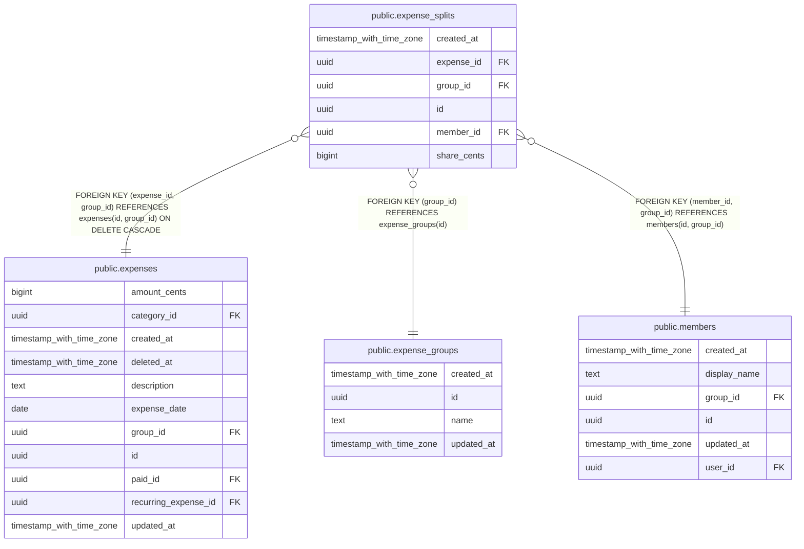

# public.expense_splits

## Description

Reparto de un gasto: una fila por miembro con la parte que le toca. Se crean junto al gasto y no se editan.

## Columns

| Name        | Type                     | Default           | Nullable | Children | Parents                                                                                                                     | Comment                                                                             |
| ----------- | ------------------------ | ----------------- | -------- | -------- | --------------------------------------------------------------------------------------------------------------------------- | ----------------------------------------------------------------------------------- |
| created_at  | timestamp with time zone | now()             | false    |          |                                                                                                                             |                                                                                     |
| expense_id  | uuid                     |                   | false    |          | [public.expenses](public.expenses.md)                                                                                       |                                                                                     |
| group_id    | uuid                     |                   | false    |          | [public.expense_groups](public.expense_groups.md) [public.members](public.members.md) [public.expenses](public.expenses.md) | Grupo del gasto. Permite filtrar y comprobar la integridad entre grupos.            |
| id          | uuid                     | gen_random_uuid() | false    |          |                                                                                                                             |                                                                                     |
| member_id   | uuid                     |                   | false    |          | [public.members](public.members.md)                                                                                         |                                                                                     |
| share_cents | bigint                   |                   | false    |          |                                                                                                                             | Parte que le toca al miembro, en céntimos. Las partes de un gasto suman su importe. |

## Constraints

| Name                                    | Type        | Definition                                                                             |
| --------------------------------------- | ----------- | -------------------------------------------------------------------------------------- |
| expense_splits_expense_id_group_id_fkey | FOREIGN KEY | FOREIGN KEY (expense_id, group_id) REFERENCES expenses(id, group_id) ON DELETE CASCADE |
| expense_splits_expense_id_member_id_key | UNIQUE      | UNIQUE (expense_id, member_id)                                                         |
| expense_splits_group_id_fkey            | FOREIGN KEY | FOREIGN KEY (group_id) REFERENCES expense_groups(id)                                   |
| expense_splits_member_id_group_id_fkey  | FOREIGN KEY | FOREIGN KEY (member_id, group_id) REFERENCES members(id, group_id)                     |
| expense_splits_pkey                     | PRIMARY KEY | PRIMARY KEY (id)                                                                       |
| expense_splits_share_cents_check        | CHECK       | CHECK ((share_cents > 0))                                                              |

## Indexes

| Name                                    | Definition                                                                                                               |
| --------------------------------------- | ------------------------------------------------------------------------------------------------------------------------ |
| expense_splits_expense_id_member_id_key | CREATE UNIQUE INDEX expense_splits_expense_id_member_id_key ON public.expense_splits USING btree (expense_id, member_id) |
| expense_splits_group_created_idx        | CREATE INDEX expense_splits_group_created_idx ON public.expense_splits USING btree (group_id, created_at)                |
| expense_splits_pkey                     | CREATE UNIQUE INDEX expense_splits_pkey ON public.expense_splits USING btree (id)                                        |

## Relations

---

> Generated by [tbls](https://github.com/k1LoW/tbls)
