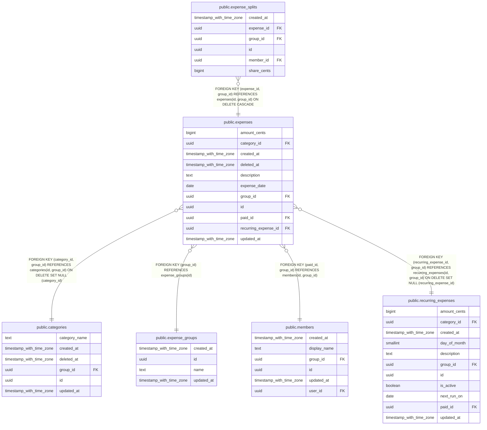

# public.expenses

## Description

Hecho central: alguien pagó una cantidad por algo. El saldo no se guarda, se calcula a partir de estas filas.

## Columns

| Name                 | Type                     | Default           | Nullable | Children                                          | Parents                                                                                                                                                                                   | Comment                                                                 |
| -------------------- | ------------------------ | ----------------- | -------- | ------------------------------------------------- | ----------------------------------------------------------------------------------------------------------------------------------------------------------------------------------------- | ----------------------------------------------------------------------- |
| amount_cents         | bigint                   |                   | false    |                                                   |                                                                                                                                                                                           | Importe en céntimos (20 EUR = 2000). Siempre mayor que 0.               |
| category_id          | uuid                     |                   | true     |                                                   | [public.categories](public.categories.md)                                                                                                                                                 | Categoría opcional del gasto.                                           |
| created_at           | timestamp with time zone | now()             | false    |                                                   |                                                                                                                                                                                           |                                                                         |
| deleted_at           | timestamp with time zone |                   | true     |                                                   |                                                                                                                                                                                           | Si tiene valor, el gasto está borrado. Nunca se borra de verdad.        |
| description          | text                     |                   | false    |                                                   |                                                                                                                                                                                           |                                                                         |
| expense_date         | date                     | CURRENT_DATE      | false    |                                                   |                                                                                                                                                                                           | Día del gasto, sin hora, para que no cambie de mes por la zona horaria. |
| group_id             | uuid                     |                   | false    | [public.expense_splits](public.expense_splits.md) | [public.expense_groups](public.expense_groups.md) [public.members](public.members.md) [public.categories](public.categories.md) [public.recurring_expenses](public.recurring_expenses.md) |                                                                         |
| id                   | uuid                     | gen_random_uuid() | false    | [public.expense_splits](public.expense_splits.md) |                                                                                                                                                                                           |                                                                         |
| paid_id              | uuid                     |                   | false    |                                                   | [public.members](public.members.md)                                                                                                                                                       | Miembro que pagó el gasto.                                              |
| recurring_expense_id | uuid                     |                   | true     |                                                   | [public.recurring_expenses](public.recurring_expenses.md)                                                                                                                                 | Plantilla recurrente de la que viene este gasto, si la hay.             |
| updated_at           | timestamp with time zone | now()             | false    |                                                   |                                                                                                                                                                                           | Se actualiza sola con un trigger. Sirve para sincronizar cambios.       |

## Constraints

| Name                                        | Type        | Definition                                                                                                                         |
| ------------------------------------------- | ----------- | ---------------------------------------------------------------------------------------------------------------------------------- |
| expenses_amount_cents_check                 | CHECK       | CHECK ((amount_cents > 0))                                                                                                         |
| expenses_category_id_group_id_fkey          | FOREIGN KEY | FOREIGN KEY (category_id, group_id) REFERENCES categories(id, group_id) ON DELETE SET NULL (category_id)                           |
| expenses_description_check                  | CHECK       | CHECK ((length(TRIM(BOTH FROM description)) > 0))                                                                                  |
| expenses_group_id_fkey                      | FOREIGN KEY | FOREIGN KEY (group_id) REFERENCES expense_groups(id)                                                                               |
| expenses_id_group_id_key                    | UNIQUE      | UNIQUE (id, group_id)                                                                                                              |
| expenses_paid_id_group_id_fkey              | FOREIGN KEY | FOREIGN KEY (paid_id, group_id) REFERENCES members(id, group_id)                                                                   |
| expenses_pkey                               | PRIMARY KEY | PRIMARY KEY (id)                                                                                                                   |
| expenses_recurring_expense_id_group_id_fkey | FOREIGN KEY | FOREIGN KEY (recurring_expense_id, group_id) REFERENCES recurring_expenses(id, group_id) ON DELETE SET NULL (recurring_expense_id) |

## Indexes

| Name                        | Definition                                                                                                                                                   |
| --------------------------- | ------------------------------------------------------------------------------------------------------------------------------------------------------------ |
| expenses_group_updated_idx  | CREATE INDEX expenses_group_updated_idx ON public.expenses USING btree (group_id, updated_at)                                                                |
| expenses_id_group_id_key    | CREATE UNIQUE INDEX expenses_id_group_id_key ON public.expenses USING btree (id, group_id)                                                                   |
| expenses_pkey               | CREATE UNIQUE INDEX expenses_pkey ON public.expenses USING btree (id)                                                                                        |
| expenses_recurring_date_key | CREATE UNIQUE INDEX expenses_recurring_date_key ON public.expenses USING btree (recurring_expense_id, expense_date) WHERE (recurring_expense_id IS NOT NULL) |

## Triggers

| Name           | Definition                                                                                                    |
| -------------- | ------------------------------------------------------------------------------------------------------------- |
| set_updated_at | CREATE TRIGGER set_updated_at BEFORE UPDATE ON public.expenses FOR EACH ROW EXECUTE FUNCTION set_updated_at() |

## Relations

---

> Generated by [tbls](https://github.com/k1LoW/tbls)
