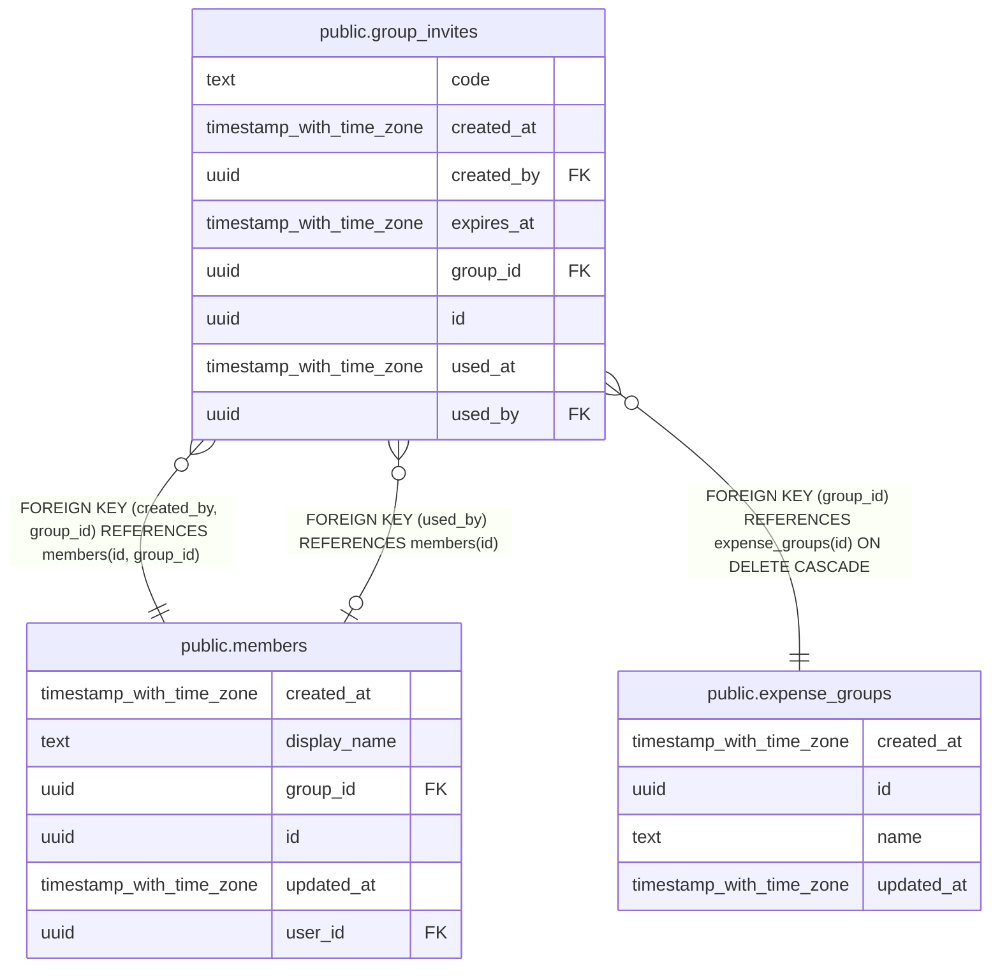

# public.group_invites

## Description

Códigos de invitación para entrar en un grupo. Caducan y son de un solo uso. Solo se tocan mediante funciones.

## Columns

| Name       | Type                     | Default           | Nullable | Children | Parents                                                                               | Comment                                            |
| ---------- | ------------------------ | ----------------- | -------- | -------- | ------------------------------------------------------------------------------------- | -------------------------------------------------- |
| code       | text                     |                   | false    |          |                                                                                       | Código que se comparte. Único en toda la tabla.    |
| created_at | timestamp with time zone | now()             | false    |          |                                                                                       |                                                    |
| created_by | uuid                     |                   | false    |          | [public.members](public.members.md)                                                   |                                                    |
| expires_at | timestamp with time zone |                   | false    |          |                                                                                       | Fecha de caducidad de la invitación.               |
| group_id   | uuid                     |                   | false    |          | [public.expense_groups](public.expense_groups.md) [public.members](public.members.md) |                                                    |
| id         | uuid                     | gen_random_uuid() | false    |          |                                                                                       |                                                    |
| used_at    | timestamp with time zone |                   | true     |          |                                                                                       | Cuándo se canjeó. Vacío significa sin usar.        |
| used_by    | uuid                     |                   | true     |          | [public.members](public.members.md)                                                   | Miembro que entró en el grupo con esta invitación. |

## Constraints

| Name                                   | Type        | Definition                                                             |
| -------------------------------------- | ----------- | ---------------------------------------------------------------------- |
| group_invites_code_check               | CHECK       | CHECK ((length(TRIM(BOTH FROM code)) > 0))                             |
| group_invites_code_key                 | UNIQUE      | UNIQUE (code)                                                          |
| group_invites_created_by_group_id_fkey | FOREIGN KEY | FOREIGN KEY (created_by, group_id) REFERENCES members(id, group_id)    |
| group_invites_group_id_fkey            | FOREIGN KEY | FOREIGN KEY (group_id) REFERENCES expense_groups(id) ON DELETE CASCADE |
| group_invites_pkey                     | PRIMARY KEY | PRIMARY KEY (id)                                                       |
| group_invites_used_by_fkey             | FOREIGN KEY | FOREIGN KEY (used_by) REFERENCES members(id)                           |

## Indexes

| Name                   | Definition                                                                            |
| ---------------------- | ------------------------------------------------------------------------------------- |
| group_invites_code_key | CREATE UNIQUE INDEX group_invites_code_key ON public.group_invites USING btree (code) |
| group_invites_pkey     | CREATE UNIQUE INDEX group_invites_pkey ON public.group_invites USING btree (id)       |

## Relations

---

> Generated by [tbls](https://github.com/k1LoW/tbls)
