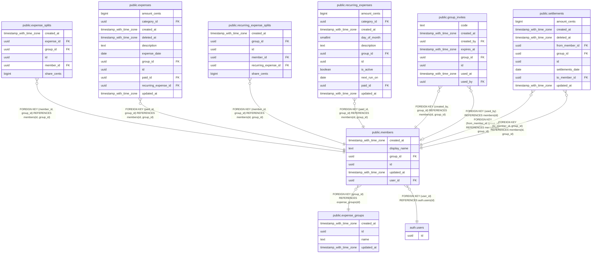

# public.members

## Description

Una persona dentro de un grupo. Se enlaza con la cuenta de login de Supabase.

## Columns

| Name         | Type                     | Default           | Nullable | Children                                                                                                                                                                                                                                                                                                            | Parents                                           | Comment                                                           |
| ------------ | ------------------------ | ----------------- | -------- | ------------------------------------------------------------------------------------------------------------------------------------------------------------------------------------------------------------------------------------------------------------------------------------------------------------------- | ------------------------------------------------- | ----------------------------------------------------------------- |
| created_at   | timestamp with time zone | now()             | false    |                                                                                                                                                                                                                                                                                                                     |                                                   |                                                                   |
| display_name | text                     |                   | false    |                                                                                                                                                                                                                                                                                                                     |                                                   | Nombre que se muestra en el grupo.                                |
| group_id     | uuid                     |                   | false    | [public.expense_splits](public.expense_splits.md) [public.expenses](public.expenses.md) [public.group_invites](public.group_invites.md) [public.recurring_expense_splits](public.recurring_expense_splits.md) [public.recurring_expenses](public.recurring_expenses.md) [public.settlements](public.settlements.md) | [public.expense_groups](public.expense_groups.md) |                                                                   |
| id           | uuid                     | gen_random_uuid() | false    | [public.expense_splits](public.expense_splits.md) [public.expenses](public.expenses.md) [public.group_invites](public.group_invites.md) [public.recurring_expense_splits](public.recurring_expense_splits.md) [public.recurring_expenses](public.recurring_expenses.md) [public.settlements](public.settlements.md) |                                                   |                                                                   |
| updated_at   | timestamp with time zone | now()             | false    |                                                                                                                                                                                                                                                                                                                     |                                                   | Se actualiza sola con un trigger. Sirve para sincronizar cambios. |
| user_id      | uuid                     |                   | false    |                                                                                                                                                                                                                                                                                                                     | [auth.users](auth.users.md)                       | Cuenta de login (auth.users) de esta persona.                     |

## Constraints

| Name                         | Type        | Definition                                           |
| ---------------------------- | ----------- | ---------------------------------------------------- |
| members_display_name_check   | CHECK       | CHECK ((length(TRIM(BOTH FROM display_name)) > 0))   |
| members_group_id_fkey        | FOREIGN KEY | FOREIGN KEY (group_id) REFERENCES expense_groups(id) |
| members_group_id_user_id_key | UNIQUE      | UNIQUE (group_id, user_id)                           |
| members_id_group_id_key      | UNIQUE      | UNIQUE (id, group_id)                                |
| members_pkey                 | PRIMARY KEY | PRIMARY KEY (id)                                     |
| members_user_id_fkey         | FOREIGN KEY | FOREIGN KEY (user_id) REFERENCES auth.users(id)      |

## Indexes

| Name                         | Definition                                                                                         |
| ---------------------------- | -------------------------------------------------------------------------------------------------- |
| members_group_id_user_id_key | CREATE UNIQUE INDEX members_group_id_user_id_key ON public.members USING btree (group_id, user_id) |
| members_group_updated_idx    | CREATE INDEX members_group_updated_idx ON public.members USING btree (group_id, updated_at)        |
| members_id_group_id_key      | CREATE UNIQUE INDEX members_id_group_id_key ON public.members USING btree (id, group_id)           |
| members_pkey                 | CREATE UNIQUE INDEX members_pkey ON public.members USING btree (id)                                |

## Triggers

| Name           | Definition                                                                                                   |
| -------------- | ------------------------------------------------------------------------------------------------------------ |
| set_updated_at | CREATE TRIGGER set_updated_at BEFORE UPDATE ON public.members FOR EACH ROW EXECUTE FUNCTION set_updated_at() |

## Relations

---

> Generated by [tbls](https://github.com/k1LoW/tbls)
