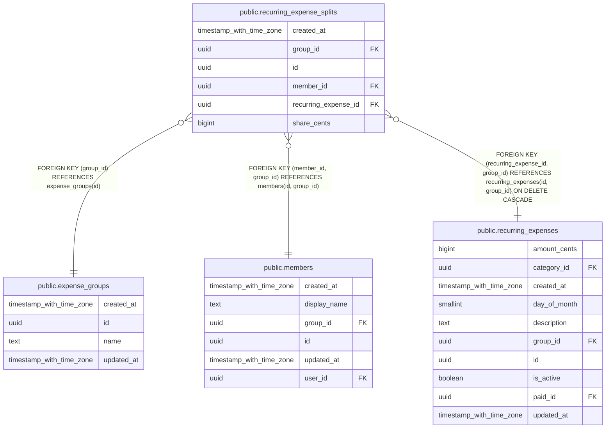

# public.recurring_expense_splits

## Description

Reparto de una plantilla recurrente. Igual que expense_splits.

## Columns

| Name                 | Type                     | Default           | Nullable | Children | Parents                                                                                                                                         | Comment |
| -------------------- | ------------------------ | ----------------- | -------- | -------- | ----------------------------------------------------------------------------------------------------------------------------------------------- | ------- |
| created_at           | timestamp with time zone | now()             | false    |          |                                                                                                                                                 |         |
| group_id             | uuid                     |                   | false    |          | [public.expense_groups](public.expense_groups.md) [public.members](public.members.md) [public.recurring_expenses](public.recurring_expenses.md) |         |
| id                   | uuid                     | gen_random_uuid() | false    |          |                                                                                                                                                 |         |
| member_id            | uuid                     |                   | false    |          | [public.members](public.members.md)                                                                                                             |         |
| recurring_expense_id | uuid                     |                   | false    |          | [public.recurring_expenses](public.recurring_expenses.md)                                                                                       |         |
| share_cents          | bigint                   |                   | false    |          |                                                                                                                                                 |         |

## Constraints

| Name                                                        | Type        | Definition                                                                                                 |
| ----------------------------------------------------------- | ----------- | ---------------------------------------------------------------------------------------------------------- |
| recurring_expense_splits_group_id_fkey                      | FOREIGN KEY | FOREIGN KEY (group_id) REFERENCES expense_groups(id)                                                       |
| recurring_expense_splits_member_id_group_id_fkey            | FOREIGN KEY | FOREIGN KEY (member_id, group_id) REFERENCES members(id, group_id)                                         |
| recurring_expense_splits_pkey                               | PRIMARY KEY | PRIMARY KEY (id)                                                                                           |
| recurring_expense_splits_recurring_expense_id_group_id_fkey | FOREIGN KEY | FOREIGN KEY (recurring_expense_id, group_id) REFERENCES recurring_expenses(id, group_id) ON DELETE CASCADE |
| recurring_expense_splits_recurring_expense_id_member_id_key | UNIQUE      | UNIQUE (recurring_expense_id, member_id)                                                                   |
| recurring_expense_splits_share_cents_check                  | CHECK       | CHECK ((share_cents > 0))                                                                                  |

## Indexes

| Name                                                        | Definition                                                                                                                                                       |
| ----------------------------------------------------------- | ---------------------------------------------------------------------------------------------------------------------------------------------------------------- |
| recurring_expense_splits_pkey                               | CREATE UNIQUE INDEX recurring_expense_splits_pkey ON public.recurring_expense_splits USING btree (id)                                                            |
| recurring_expense_splits_recurring_expense_id_member_id_key | CREATE UNIQUE INDEX recurring_expense_splits_recurring_expense_id_member_id_key ON public.recurring_expense_splits USING btree (recurring_expense_id, member_id) |
| recurring_splits_group_created_idx                          | CREATE INDEX recurring_splits_group_created_idx ON public.recurring_expense_splits USING btree (group_id, created_at)                                            |

## Relations

---

> Generated by [tbls](https://github.com/k1LoW/tbls)
