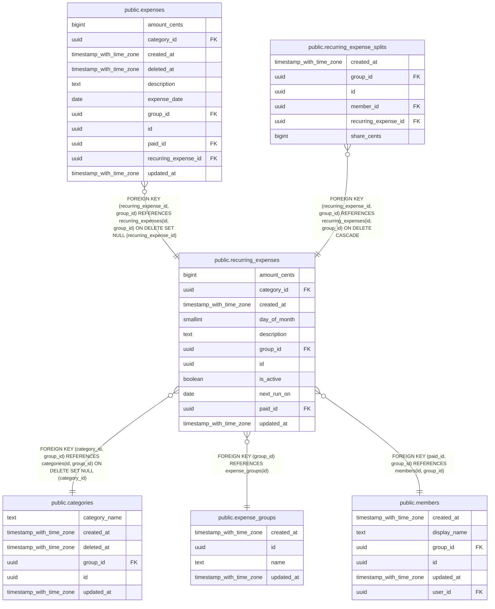

# public.recurring_expenses

## Description

Plantilla de un gasto que se repite cada mes. No es un gasto: genera uno real cada mes.

## Columns

| Name         | Type                     | Default           | Nullable | Children                                                                                                    | Parents                                                                                                                         | Comment                                                                                                       |
| ------------ | ------------------------ | ----------------- | -------- | ----------------------------------------------------------------------------------------------------------- | ------------------------------------------------------------------------------------------------------------------------------- | ------------------------------------------------------------------------------------------------------------- |
| amount_cents | bigint                   |                   | false    |                                                                                                             |                                                                                                                                 |                                                                                                               |
| category_id  | uuid                     |                   | true     |                                                                                                             | [public.categories](public.categories.md)                                                                                       |                                                                                                               |
| created_at   | timestamp with time zone | now()             | false    |                                                                                                             |                                                                                                                                 |                                                                                                               |
| day_of_month | smallint                 |                   | false    |                                                                                                             |                                                                                                                                 | Día del mes en que toca, entre 1 y 28 (el 29, 30 y 31 no existen en todos los meses).                         |
| description  | text                     |                   | false    |                                                                                                             |                                                                                                                                 |                                                                                                               |
| group_id     | uuid                     |                   | false    | [public.expenses](public.expenses.md) [public.recurring_expense_splits](public.recurring_expense_splits.md) | [public.expense_groups](public.expense_groups.md) [public.members](public.members.md) [public.categories](public.categories.md) |                                                                                                               |
| id           | uuid                     | gen_random_uuid() | false    | [public.expenses](public.expenses.md) [public.recurring_expense_splits](public.recurring_expense_splits.md) |                                                                                                                                 |                                                                                                               |
| is_active    | boolean                  | true              | false    |                                                                                                             |                                                                                                                                 | Permite pausar o terminar la plantilla sin borrarla.                                                          |
| next_run_on  | date                     |                   | false    |                                                                                                             |                                                                                                                                 | Próxima fecha en la que toca generar un gasto real. La actualiza solo la función generate_recurring_expenses. |
| paid_id      | uuid                     |                   | false    |                                                                                                             | [public.members](public.members.md)                                                                                             |                                                                                                               |
| updated_at   | timestamp with time zone | now()             | false    |                                                                                                             |                                                                                                                                 | Se actualiza sola con un trigger. Sirve para sincronizar cambios.                                             |

## Constraints

| Name                                         | Type        | Definition                                                                                               |
| -------------------------------------------- | ----------- | -------------------------------------------------------------------------------------------------------- |
| recurring_expenses_amount_cents_check        | CHECK       | CHECK ((amount_cents > 0))                                                                               |
| recurring_expenses_category_id_group_id_fkey | FOREIGN KEY | FOREIGN KEY (category_id, group_id) REFERENCES categories(id, group_id) ON DELETE SET NULL (category_id) |
| recurring_expenses_day_of_month_check        | CHECK       | CHECK (((day_of_month >= 1) AND (day_of_month <= 28)))                                                   |
| recurring_expenses_description_check         | CHECK       | CHECK ((length(TRIM(BOTH FROM description)) > 0))                                                        |
| recurring_expenses_group_id_fkey             | FOREIGN KEY | FOREIGN KEY (group_id) REFERENCES expense_groups(id)                                                     |
| recurring_expenses_id_group_id_key           | UNIQUE      | UNIQUE (id, group_id)                                                                                    |
| recurring_expenses_paid_id_group_id_fkey     | FOREIGN KEY | FOREIGN KEY (paid_id, group_id) REFERENCES members(id, group_id)                                         |
| recurring_expenses_pkey                      | PRIMARY KEY | PRIMARY KEY (id)                                                                                         |

## Indexes

| Name                                 | Definition                                                                                                        |
| ------------------------------------ | ----------------------------------------------------------------------------------------------------------------- |
| recurring_expenses_group_updated_idx | CREATE INDEX recurring_expenses_group_updated_idx ON public.recurring_expenses USING btree (group_id, updated_at) |
| recurring_expenses_id_group_id_key   | CREATE UNIQUE INDEX recurring_expenses_id_group_id_key ON public.recurring_expenses USING btree (id, group_id)    |
| recurring_expenses_pkey              | CREATE UNIQUE INDEX recurring_expenses_pkey ON public.recurring_expenses USING btree (id)                         |

## Triggers

| Name           | Definition                                                                                                              |
| -------------- | ----------------------------------------------------------------------------------------------------------------------- |
| set_updated_at | CREATE TRIGGER set_updated_at BEFORE UPDATE ON public.recurring_expenses FOR EACH ROW EXECUTE FUNCTION set_updated_at() |

## Relations

---

> Generated by [tbls](https://github.com/k1LoW/tbls)
