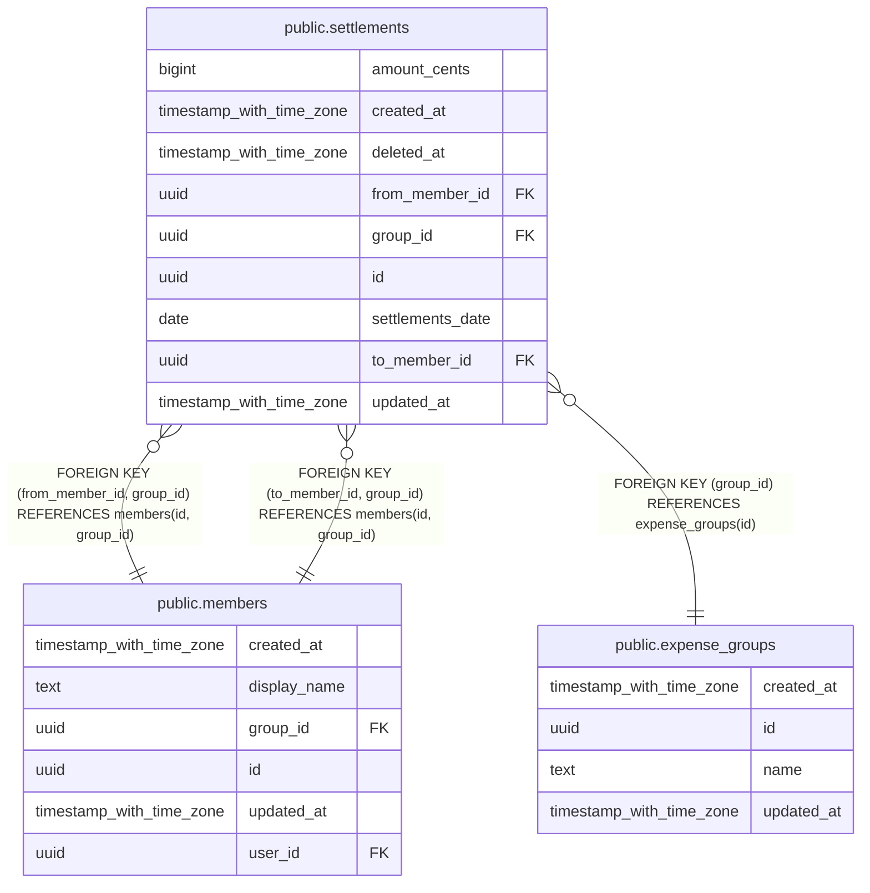

# public.settlements

## Description

Pagos entre dos miembros para saldar deuda. No son gastos: no hay compra ni categoría.

## Columns

| Name             | Type                     | Default           | Nullable | Children | Parents                                                                               | Comment                                                           |
| ---------------- | ------------------------ | ----------------- | -------- | -------- | ------------------------------------------------------------------------------------- | ----------------------------------------------------------------- |
| amount_cents     | bigint                   |                   | false    |          |                                                                                       | Importe en céntimos. Siempre mayor que 0.                         |
| created_at       | timestamp with time zone | now()             | false    |          |                                                                                       |                                                                   |
| deleted_at       | timestamp with time zone |                   | true     |          |                                                                                       | Si tiene valor, el pago está borrado. Nunca se borra de verdad.   |
| from_member_id   | uuid                     |                   | false    |          | [public.members](public.members.md)                                                   | Miembro que paga.                                                 |
| group_id         | uuid                     |                   | false    |          | [public.expense_groups](public.expense_groups.md) [public.members](public.members.md) |                                                                   |
| id               | uuid                     | gen_random_uuid() | false    |          |                                                                                       |                                                                   |
| settlements_date | date                     | CURRENT_DATE      | false    |          |                                                                                       |                                                                   |
| to_member_id     | uuid                     |                   | false    |          | [public.members](public.members.md)                                                   | Miembro que recibe el pago.                                       |
| updated_at       | timestamp with time zone | now()             | false    |          |                                                                                       | Se actualiza sola con un trigger. Sirve para sincronizar cambios. |

## Constraints

| Name                                     | Type        | Definition                                                              |
| ---------------------------------------- | ----------- | ----------------------------------------------------------------------- |
| settlements_amount_cents_check           | CHECK       | CHECK ((amount_cents > 0))                                              |
| settlements_check                        | CHECK       | CHECK ((from_member_id <> to_member_id))                                |
| settlements_from_member_id_group_id_fkey | FOREIGN KEY | FOREIGN KEY (from_member_id, group_id) REFERENCES members(id, group_id) |
| settlements_group_id_fkey                | FOREIGN KEY | FOREIGN KEY (group_id) REFERENCES expense_groups(id)                    |
| settlements_pkey                         | PRIMARY KEY | PRIMARY KEY (id)                                                        |
| settlements_to_member_id_group_id_fkey   | FOREIGN KEY | FOREIGN KEY (to_member_id, group_id) REFERENCES members(id, group_id)   |

## Indexes

| Name                          | Definition                                                                                          |
| ----------------------------- | --------------------------------------------------------------------------------------------------- |
| settlements_group_updated_idx | CREATE INDEX settlements_group_updated_idx ON public.settlements USING btree (group_id, updated_at) |
| settlements_pkey              | CREATE UNIQUE INDEX settlements_pkey ON public.settlements USING btree (id)                         |

## Triggers

| Name           | Definition                                                                                                       |
| -------------- | ---------------------------------------------------------------------------------------------------------------- |
| set_updated_at | CREATE TRIGGER set_updated_at BEFORE UPDATE ON public.settlements FOR EACH ROW EXECUTE FUNCTION set_updated_at() |

## Relations

---

> Generated by [tbls](https://github.com/k1LoW/tbls)
